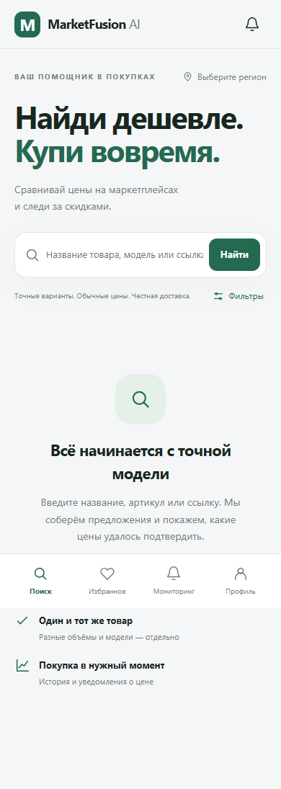

# MarketFusion AI

Telegram-бот, Mini App и веб-приложение для поиска товаров, сравнения обычных цен, избранного, анализа отзывов и наблюдения за выбранным вариантом товара.

Ветка `feature/marketfusion-v2` — модернизация на базе `c2042cc`. Production на `feature/core-integration` не обновлялся: по §14 ТЗ требуется отдельное разрешение владельца. **Полный MVP по всем площадкам пока не подтверждён.**

## Возможности V2

- Общий поисковый движок для бота и Web: десять независимых источников, промежуточные результаты, отмена, ограничение конкурентности, кэш и диагностика ошибок.
- Отдельные товар, вариант, предложение и доставка. Несовместимые модели, объёмы, форм-факторы и аксессуары исключаются из точного сравнения; похожие результаты показаны отдельно.
- Обычные цены отделены от условных скидок. Доставка и итог считаются только по подтверждённым данным для выбранного региона. Текущие адаптеры не подтверждают регион, поэтому региональный мониторинг на этих данных недоступен до расширения источников.
- Наблюдение за выбранным вариантом или предложением: семь условий, измеренная история, cooldown, восстановление worker и события уведомлений. Старые текстовые наблюдения сохранены и требуют выбора товара.
- Новый адаптивный интерфейс: поиск, избранное, мониторинг и профиль; темы Telegram/системы, фильтры, сортировка, карточка и история. Сохранены роли, настройки ИИ, отзывы и фото-поиск бота.
- Версионированные PostgreSQL-миграции, серверная изоляция пользователей и учёт реально возвращённых провайдером токенов ИИ. Без тарифов денежная стоимость не выдумывается.

[Отчёт и таблица всех площадок](docs/MARKETFUSION_V2_VERIFICATION.md) · [ТЗ](docs/MARKETFUSION_V2_REQUIREMENTS_RU.md) · [API](docs/MARKETFUSION_V2_API.md) · [Запуск и откат](docs/MARKETFUSION_V2_RELEASE.md).

## Быстрый локальный запуск V2

Нужен Docker Desktop с Compose. Из корня этой ветки:

```powershell
powershell -NoProfile -ExecutionPolicy Bypass -File deployment/scripts/start_v2_staging.ps1
```

Открыть `http://127.0.0.1:8089`. Локальный пароль `V2_WEB_PASSWORD` хранится в автоматически созданном игнорируемом `.env.v2-staging`. Стенд имеет отдельную БД, не запускает рабочий Telegram-бот и не содержит production-ключей. Поиск не подменяется тестовым каталогом. Опциональный Chrome и команды проверок описаны в инструкции запуска.



Дополнительные [мобильный](docs/qa/v2-mobile-search-fixture.png) и [десктопный](docs/qa/v2-desktop-search-fixture.png) снимки используют **API-фикстуры для проверки интерфейса** и не доказывают доступ к маркетплейсам.

## Сохранённые модули и прежняя версия

Ниже описаны сохранённые модули и прежний production-запуск. Исторические живые пробы: [статус источников](docs/MVP_SOURCE_STATUS_RU.md).

## Подключено

- Общий Python backend и Telegram-бот на основе Smart Shopper: поиск Ozon и Яндекс Маркета, анализ отзывов, сравнение, поиск по фото в боте и LLM-логика исходного проекта.
- Коннекторы ru-marketplace-mcp размещены в `integrations/ru-marketplace-mcp`. `GET /api/marketplaces/search?q=...` вызывает их общий модуль сравнения и возвращает состояние каждого источника. Некоторые площадки требуют браузерной сессии или подходящего IP.
- Один React frontend для браузера и Telegram Mini App. В браузере вход по паролю, в Telegram проверка `initData` на backend.
- Общее PostgreSQL-хранилище для сессий, кэша, избранного, настроек и счётчика LLM. SQLite доступен для разработки без Docker.
- Мониторинг цен в PostgreSQL: наблюдения с интервалами от 15 минут до суток, история проверок, пороговые уведомления в вебе и Telegram. Отдельный worker восстанавливает расписание после перезапуска.
- Настройки OpenAI-совместимых LLM-провайдеров через админ-экран: зашифрованные ключи, модели и назначение задач. Поддерживаются AITUNNEL, OpenAI, Qwen, DeepSeek и произвольный совместимый API; для Kimi необходимо ввести Base URL своего API. Без ключей базовый поиск работает без LLM.
- Super Admin может просматривать пользователей, назначать роли `admin` и `user` и читать журнал административных действий через веб и Mini App. В боте доступны `/admin_users`, `/admin_role <Telegram ID> <admin|user>`, `/admin_audit`; они ограничены `TELEGRAM_ADMIN_IDS`.
- Роль Admin может видеть сводку по пользователям, активным и ошибочным наблюдениям и уведомлениям через веб, Mini App и команду бота `/admin_stats`. Управление API-ключами остаётся у Super Admin.
- Исходники расширения Cennik в `browser-extension`. Кнопка «Найти дешевле» открывает текущий товар в общем веб-поиске MarketFusion с той же веб-сессией. Собственный локальный мониторинг Cennik пока не синхронизирован с API.
- Для Chrome соберите Manifest V3 пакет командой `cd browser-extension; ./build-chrome.ps1` на Windows или `cd browser-extension && ./build-chrome.sh` на Linux; загрузите папку `dist-chrome` как распакованное расширение. Для Firefox используется `browser-extension/manifest.json`.

## Прежний локальный запуск (общий Compose)

Нужен Docker Desktop с Compose. Скопируйте `.env.example` в `.env` и замените `POSTGRES_PASSWORD`, `WEB_ADMIN_PASSWORD`, `WEB_SESSION_SECRET` на уникальные значения. Сгенерируйте `LLM_ENCRYPTION_KEY` командой `python -c "from cryptography.fernet import Fernet; print(Fernet.generate_key().decode())"` в установленном окружении Python с пакетом `cryptography`. Для Telegram задайте `SHOPPER_BOT_TOKEN`, `TELEGRAM_ADMIN_IDS` и публичный HTTPS-адрес `SHOPPER_MINIAPP_URL`.

```powershell
./install.bat
./start.bat
```

Откройте `http://localhost:8080`. Для запуска бота: `docker compose --profile telegram up -d`. Остановка: `./stop.bat`.

На Linux используйте `./install.sh`, `./start.sh`, `./stop.sh`. Для HTTPS на VPS задайте `DOMAIN` в `.env` и запустите `docker compose -f docker-compose.yml -f docker-compose.prod.yml --profile telegram up -d --build`. Домен должен указывать на VPS, порты 80/443 должны быть открыты. База хранится в Docker volume `postgres_data`.

## API

- `GET /health` — проверка процесса.
- `POST /api/auth/login` — вход веб-администратора по паролю из окружения.
- `GET /api/marketplaces/search?q=...` — агрегированный поиск по установленным коннекторам.
- `/api/watches`, `/api/watches/{id}/history`, `/api/notifications` — мониторинг, история и уведомления. В боте команды `/watch`, `/watches`, `/history`, `/unwatch`, `/notifications`.
- `/api/admin/ai/providers`, `/api/admin/ai/routes` — настройка ИИ-провайдеров и маршрутизации; доступны веб-администратору и Telegram ID из `TELEGRAM_ADMIN_IDS`.
- `/api/admin/users`, `/api/admin/users/{id}/role`, `/api/admin/audit` — пользователи, роли и журнал действий Super Admin.
- `/api/admin/overview` — сводка для Admin и Super Admin.
- `/api/search`, `/api/compare`, `/api/reviews`, `/api/budget`, `/api/stats` — функции Smart Shopper.

Поиск требует веб-сессию или проверенные Telegram `initData`. Секреты остаются в `.env` на сервере.

## Состояние интеграции

Роли пользователей и журнал действий добавлены, но гибкие разрешения для роли Admin и полный паритет административных функций между интерфейсами ещё не реализованы. В V2 добавлены правила мониторинга и учёт реально возвращённых токенов; полная синхронизация расширения Cennik с API остаётся отдельной задачей. AITUNNEL проверен с реальным ключом на текстовом маршруте `deepseek-chat`. На новом VPS Яндекс Маркет возвращает обычные цены; Wildberries после обновления подтвердил по пять обычных цен для двух запросов; DNS возвращает карточки без цен; Ozon блокирует поиск. Наличие исходников в репозитории не означает готовность всех функций. Grex и PriceWatch не предоставляют лицензии на свой код; их функции можно реализовать самостоятельно без переноса исходников.

Сведения о происхождении компонентов: [docs/SOURCES.md](docs/SOURCES.md). Проверенные открытые альтернативы и их ограничения: [docs/GITHUB_SOURCE_RESEARCH_RU.md](docs/GITHUB_SOURCE_RESEARCH_RU.md). Требования к лицензированным данным Ozon и Wildberries и черновик запроса поставщику: [docs/LICENSED_MARKETPLACE_DATA_RU.md](docs/LICENSED_MARKETPLACE_DATA_RU.md). Работа с GitHub: [docs/GITHUB_WORKFLOW_RU.md](docs/GITHUB_WORKFLOW_RU.md).

## Последний проверенный production-запуск (до V2, 15 ноября 2026)

Рабочая ветка `feature/core-integration` запущена в `/opt/marketfusion` на VPS `48.103.149.93`. Публичный адрес: https://marketfusionai.kosmo-connect.ru. Nginx проксирует HTTPS на локальный порт `127.0.0.1:8088`; сертификат Let's Encrypt обновляется через Certbot. Сервисы `db`, `api`, `web`, `worker`, `bot` и закрытый браузер `chrome` работают через Docker Compose. На сервере 1 ГБ RAM и 4 ГБ swap. Файл `.env` хранится с правами `600`, PostgreSQL и профиль браузера находятся в Docker volumes. Резервные копии финального дампа БД и профиля браузера хранятся на новом VPS в `/root`.

Для этой конфигурации в `.env` нужны `WEB_BIND=127.0.0.1`, `WEB_PORT=8088`, `WEB_COOKIE_SECURE=1`, `SHOPPER_DEMO_MODE=0`, публичный `SHOPPER_MINIAPP_URL` и закрытый `TELEGRAM_SOCKS_PROXY`. SOCKS5 остаётся на прежнем финском VPS и используется только запросами бота и worker к Telegram; прямой Telegram API с нового VPS не отвечал. Обновление рабочей ветки: `git pull --ff-only origin feature/core-integration` в `/opt/marketfusion`, затем `docker compose -f docker-compose.yml -f docker-compose.browser.yml --profile telegram up -d --build`. Перед обновлением схемы базы сделайте резервную копию. Не запускайте одновременно второго экземпляра бота с long polling.

AITUNNEL настроен через админ API с моделью `deepseek-chat` для текстовых задач; ключ зашифрован в БД. После переноса подтверждены HTTPS, авторизация владельца, избранное, поиск Яндекс Маркета, запись реальной цены worker в историю временного наблюдения, исходящий доступ бота и worker к Telegram через SOCKS5, а также реальный ответ бота и открытие Mini App в Telegram-клиенте. После обновления чтения JSON страницы публичные запросы WB `ssd` и `kingston nv3` вернули по пять обычных цен. DNS после исправления ожидания проверки браузера вернул пять карточек без цен. Стабильность под нагрузкой ещё не подтверждена. Совместный запрос WB + Яндекс Маркета вернул обычные цены обеих площадок, но не доказал сравнение идентичного товара; подробности в матрице выше. Наличие коннектора в коде не означает гарантированную доступность площадки. Полный MVP по всем заявленным площадкам пока не завершён.
